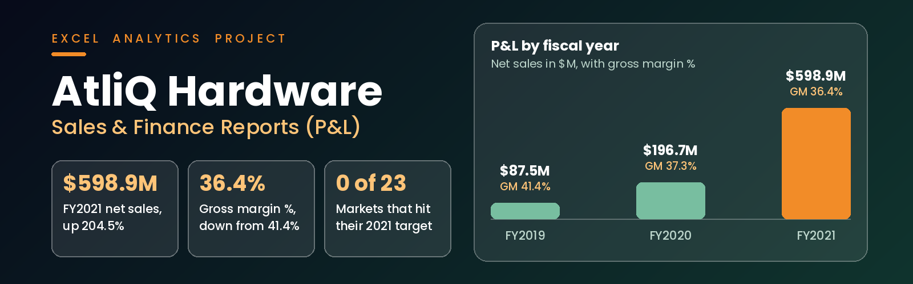
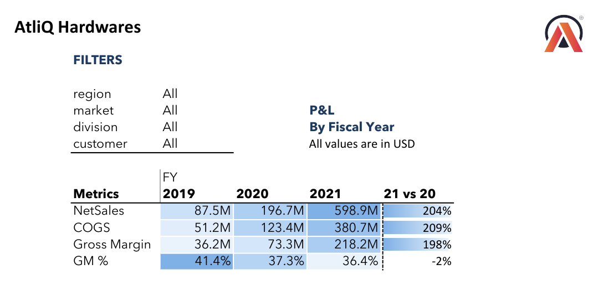
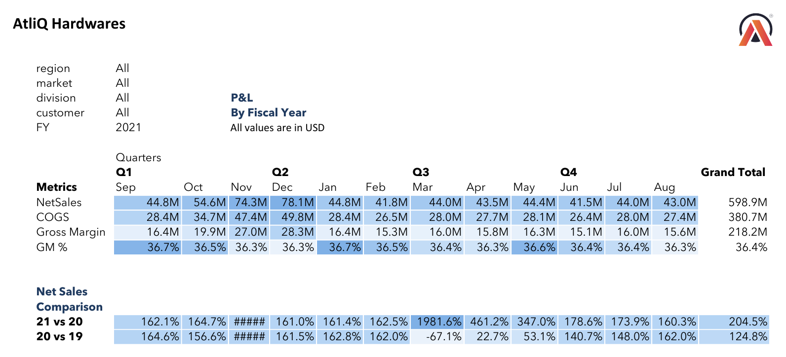
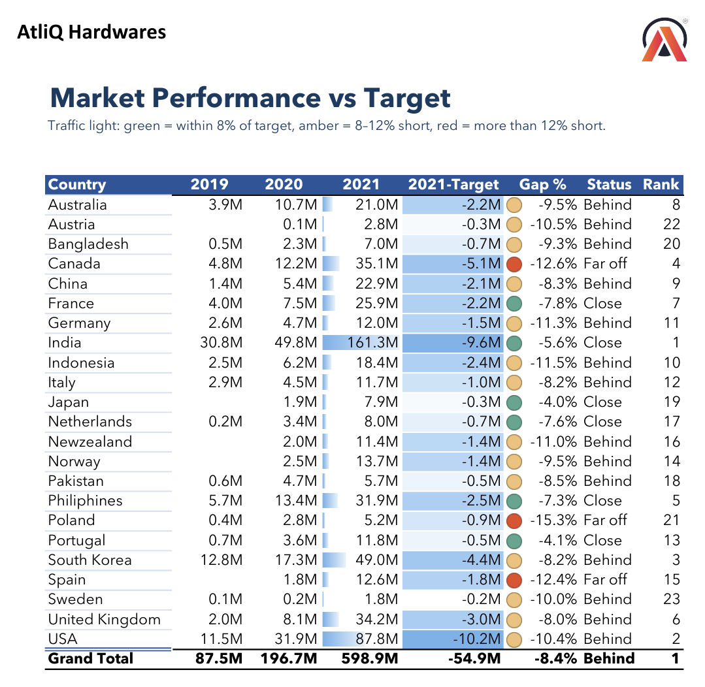
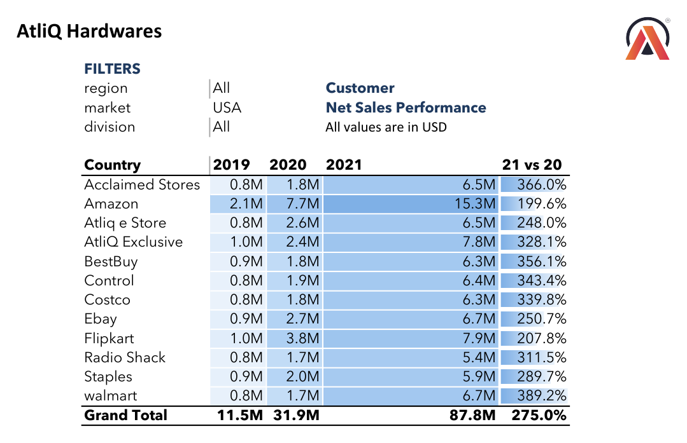

<p align="center">
  
</p>

<p align="center">
  <a href="#context"><b>Context</b></a> &nbsp;·&nbsp;
  <a href="#questions"><b>Business Questions</b></a> &nbsp;·&nbsp;
  <a href="#insights"><b>Insights</b></a> &nbsp;·&nbsp;
  <a href="#build"><b>How It Was Built</b></a> &nbsp;·&nbsp;
  <a href="#gallery"><b>Reports</b></a> &nbsp;·&nbsp;
  <a href="docs/report_walkthrough.md"><b>Full Walkthrough →</b></a>
</p>

> **In one line:** I built five sales and finance reports in Excel for AtliQ Hardware, using Power Query to clean the data, Power Pivot to model it and DAX to calculate net sales, COGS, gross margin and performance against target for FY2019 to FY2021.

<a id="context"></a>

## 🏢 Business Context

**AtliQ Hardware** sells PCs, peripherals and networking products in 23 markets through retailers, e-commerce platforms and its own stores. Management asked for one place to see how sales and profit had moved over three fiscal years, which customers and markets drive the business, and whether each market is on track for its 2021 sales target.

| Team | What they need |
|---|---|
| **Sales** | How each customer and market is performing, and how far each market is from its target |
| **Finance** | A profit and loss (P&L) view of net sales, COGS and gross margin by year, month, quarter and country |
| **Leadership** | A quick answer to "are we growing profitably?" |

> 📌 **Fiscal year:** AtliQ's fiscal year starts in **September**. FY2021 runs from Sep 2020 to Aug 2021. All values are in USD.

<a id="questions"></a>

## 🎯 Business Questions Answered

| # | Report | Business question | Team | Answer |
|:-:|---|---|---|:-:|
| 1 | Customer Net Sales Performance | How have net sales for each customer changed from FY2019 to FY2021, overall and within one market? | Sales | [R1](docs/report_walkthrough.md#r1) |
| 2 | Market Performance vs Target | Which markets met their FY2021 net sales target, and how far short is each one? | Sales | [R2](docs/report_walkthrough.md#r2) |
| 3 | P&L by Fiscal Year | How did net sales, COGS, gross margin and GM % change year on year? | Finance | [R3](docs/report_walkthrough.md#r3) |
| 4 | P&L by Fiscal Month and Quarter | How does performance move through the year, and which months drive the most sales? | Finance | [R4](docs/report_walkthrough.md#r4) |
| 5 | P&L by Country | Which markets are growing profitably, and where is margin under pressure? | Finance | [R5](docs/report_walkthrough.md#r5) |

All reports have slicers for **region, market, division and customer**, so one report answers the same question for any slice of the business.

<a id="insights"></a>

## 💡 Key Insights

| # | Finding | Evidence |
|:-:|---|---|
| 1 | **Sales grew 6.8 times in two years** | $87.5M (FY2019) to $196.7M (+124.8%) to **$598.9M** (+204.5%) |
| 2 | **Growth is getting less profitable.** COGS grew faster than sales in both years | GM % fell from **41.4%** to 37.3% to **36.4%**. Cost per $100 of sales rose from $58.57 to $63.57 |
| 3 | **No market hit its FY2021 target** | Total shortfall **$54.9M (8.4%)**. 6 markets Close, 14 Behind, 3 Far off |
| 4 | **The biggest misses are in big markets** | USA short by **$10.2M**, India by $9.6M, Canada by $5.1M. Poland is furthest off at -15.3% |
| 5 | **India is the largest market but earns a below-average margin** | $161.3M, **26.9%** of FY2021 net sales, at a 32.0% GM % against 36.4% overall |
| 6 | **November and December bring in a quarter of the year's sales** | 25.3% in FY2019 and 25.5% in FY2021 |
| 7 | **COVID hit March 2020 hard, then sales recovered** | Net sales fell to **$2.1M** from $6.4M a year earlier (-67.1%) and were back to $14.9M by June |
| 8 | **Margin moved very differently by market** | Up: UK 34.1% to 45.1%, New Zealand 26.4% to 48.2%. Down: Australia 45.9% to 32.9%, Germany 35.6% to 26.2% |
| 9 | **A few customers carry the business** | Amazon $82.1M (13.7% of FY2021), AtliQ Exclusive $61.1M, Atliq e Store $53.0M |

<a id="build"></a>

## 🛠 How It Was Built

```
CSV files (sales, customers, products, markets, costs, targets)
        |
        v
  POWER QUERY   clean, fix data types, correct typos, build a fiscal date table
        |
        v
  POWER PIVOT   star schema: 1 fact table, 4 dimensions, 1 target table
        |
        v
  DAX           NetSales, COGS, Gross Margin, GM %, year measures, Target, Gap %, Status, Rank
        |
        v
  PIVOT REPORTS 2 sales reports + 3 P&L reports, with slicers and conditional formatting
```

**Data model**

| Table | Type | Key columns |
|---|---|---|
| `fact_sales_monthly_with_cost` | Fact | date, product_code, customer_code, Qty, net_sales_amount, freight_cost, manufacturing_cost |
| `dim_customer` | Dimension | customer_code, customer, market, platform, channel |
| `dim_market` | Dimension | market, sub_zone, region |
| `dim_product` | Dimension | product_code, division, segment, category, product, variant |
| `dim_date` | Dimension (built in Power Query) | date, month, FY, mmm, quarter, fy_month_no |
| `ns_targets_2021` | Targets | market, date, ns_target |

**Data cleaning in Power Query** ([full M code](power-query/queries.m))

- Fixed customer name typos: `Atliq Exclusive` and `AltiQ Exclusive` became `AtliQ Exclusive`
- Replaced `nan` with `NA` in the market `sub_zone` and `region` columns
- Converted negative quantities to positive with `Number.Abs`
- Promoted headers and set correct data types on every table
- Generated a date table from Sep 2018 to Aug 2021 with a fiscal year column (calendar date plus 4 months)

**DAX measures:** see [`dax/measures.md`](dax/measures.md).

## 🧰 Skills Demonstrated

| Area | What was used |
|---|---|
| **ETL** | Power Query: folder and CSV imports, type changes, value replacement, custom columns |
| **Data modelling** | Power Pivot star schema with relationships across 6 tables |
| **DAX** | `SUM`, `CALCULATE`, `DIVIDE`, `RANKX`, `ALLSELECTED`, `SWITCH(TRUE())`, `VAR` |
| **Date intelligence** | Fiscal year, fiscal month order and fiscal quarters (Sep to Aug) |
| **Reporting** | Pivot tables, slicers, data bars, colour scales, traffic-light icon sets |
| **Finance** | P&L structure: net sales, COGS, gross margin, GM %, growth against last year |
| **Sales** | Customer and market performance, target gap analysis and market ranking |

<a id="gallery"></a>

## 🖼 Report Gallery

*Click any image to open it full size. Each report is also in [`reports/`](reports) as a PDF.*

<table>
  <tr>
    <td align="center" width="50%"><b>P&L by Fiscal Year</b><br><br><a href="images/02_pl_by_fy_v2.png"></a></td>
    <td align="center" width="50%"><b>P&L by Month and Quarter, FY2021</b><br><br><a href="images/04_pl_by_month_fy2021.png"></a></td>
  </tr>
  <tr>
    <td align="center" width="50%"><b>Market Performance vs Target</b><br><br><a href="images/10_market_vs_target_v3.png"></a></td>
    <td align="center" width="50%"><b>Customer Net Sales, USA</b><br><br><a href="images/07_customer_sales_usa.png"></a></td>
  </tr>
</table>

## 📁 Repository Structure

```
AtliQ-Excel-PL-Sales-Finance-Reports/
|-- README.md
|-- .gitignore
|-- docs/
|   `-- report_walkthrough.md     question, method, screenshot and answer for every report
|-- power-query/
|   `-- queries.m                 all Power Query (M) code from the workbook
|-- dax/
|   `-- measures.md               DAX measures and calculated columns
|-- reports/                      final reports exported as PDF
`-- images/                       report screenshots, numbered in build order
```

## ▶️ How to Use

1. Open any PDF in [`reports/`](reports) to see the finished reports.
2. Read the [walkthrough](docs/report_walkthrough.md) for how each report was built and what it shows.
3. To rebuild it, load the course CSV files with the code in [`power-query/queries.m`](power-query/queries.m), change the folder paths to your own, then add the measures from [`dax/measures.md`](dax/measures.md).

## 👤 About the Author

**Muhammad Raheel Yousaf** · Aspiring Data Analyst · Excel · SQL · Power BI

<a href="https://github.com/mraheelyousaf4"></a>
<a href="https://www.linkedin.com/in/muhammad-raheel-yousaf-da"></a>

**Acknowledgement:** completed as part of the Codebasics Data Analytics Bootcamp (Excel module). Dataset and business case by Codebasics.

<p align="center"><i>If this project helped you, consider giving it a ⭐</i></p>
