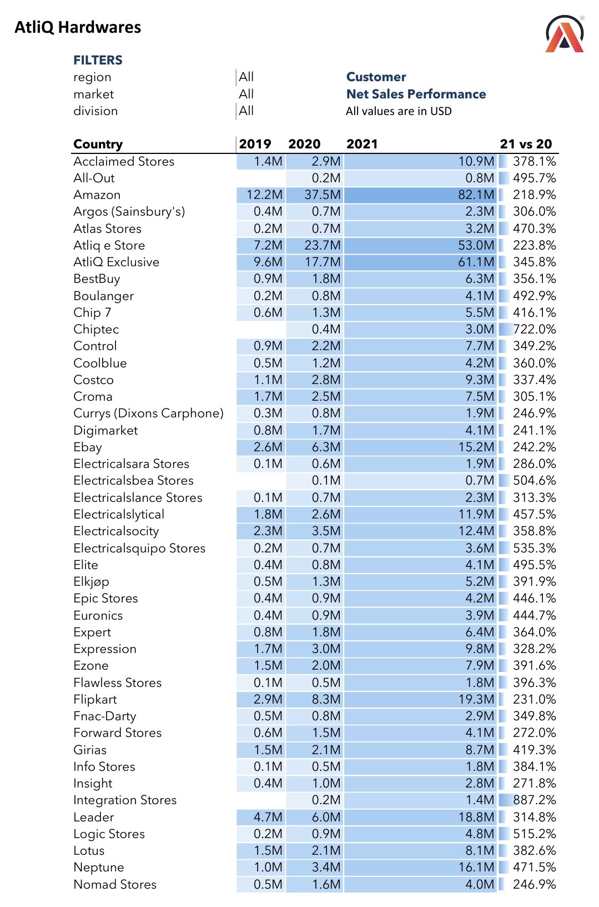
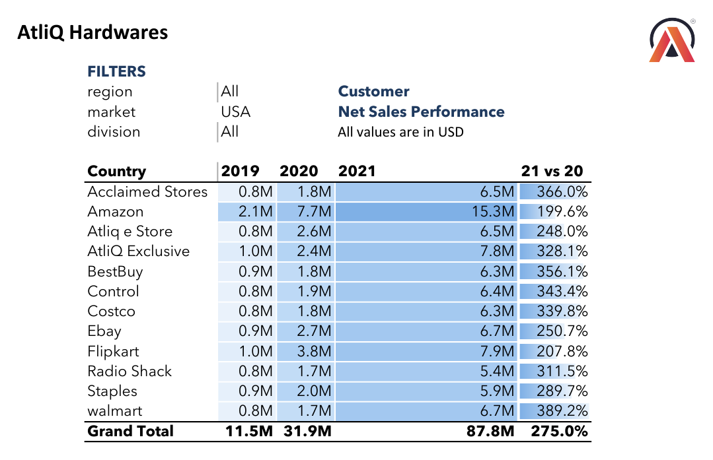
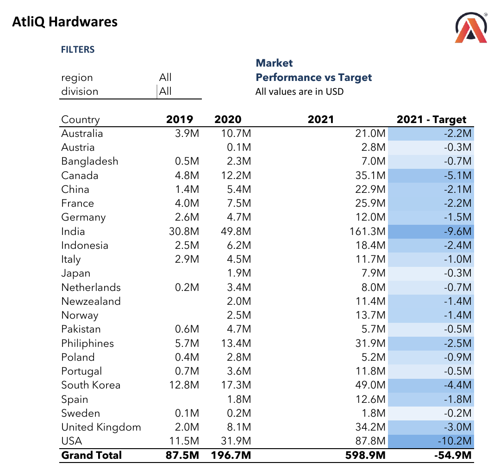
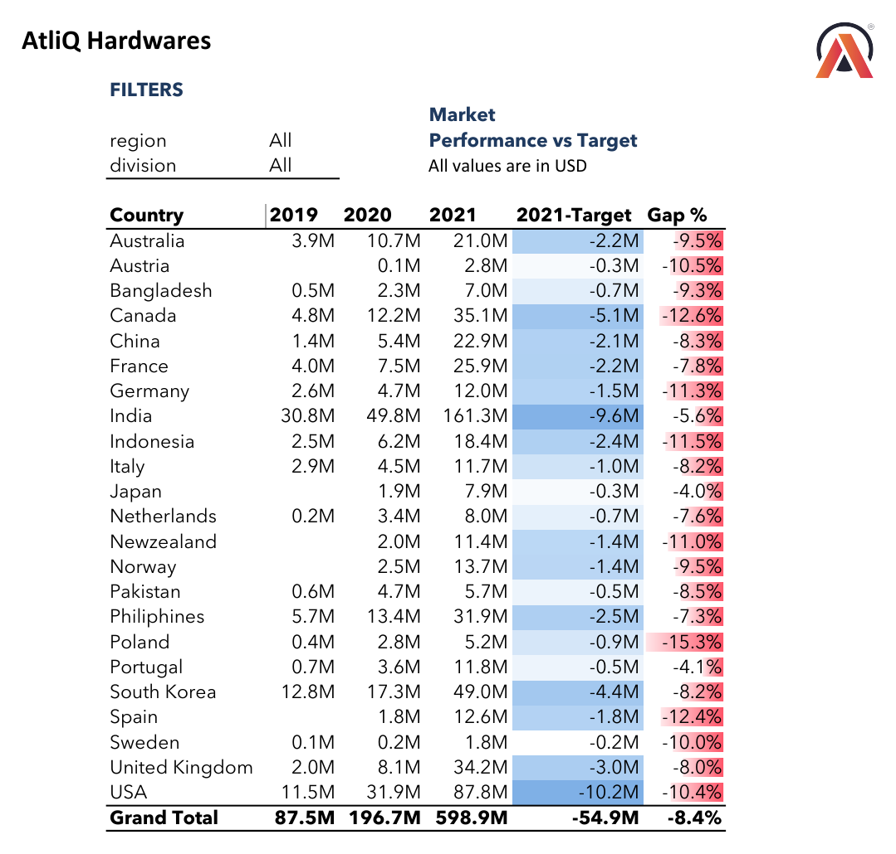
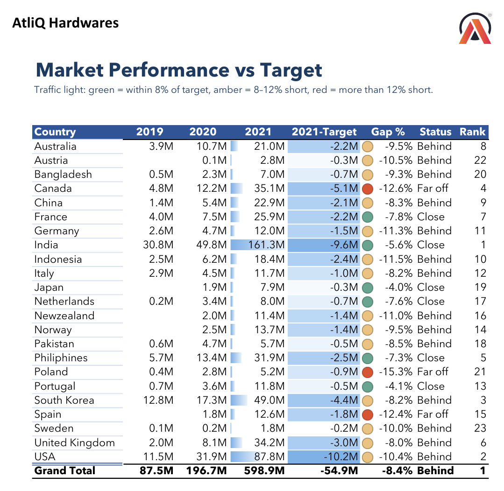
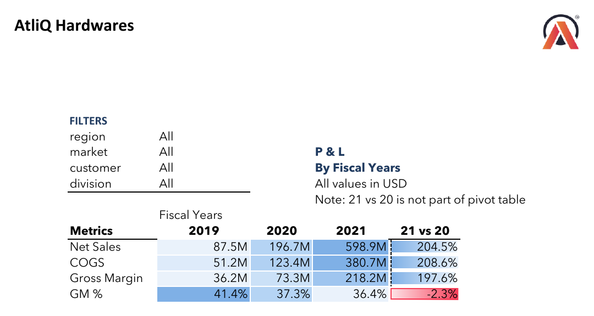
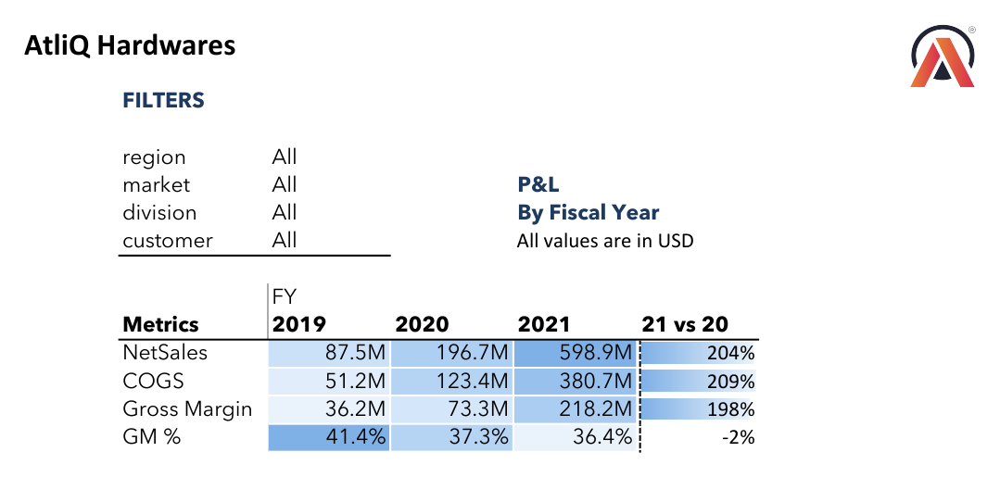
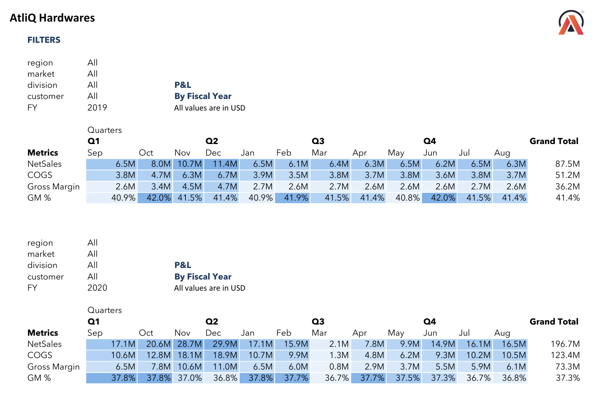
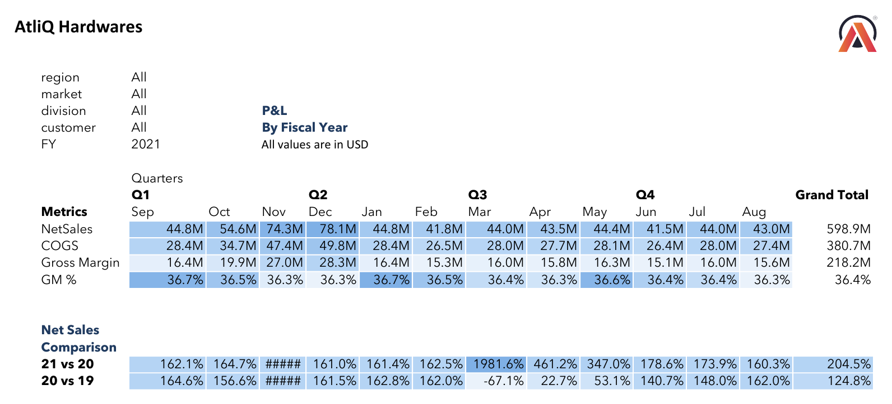
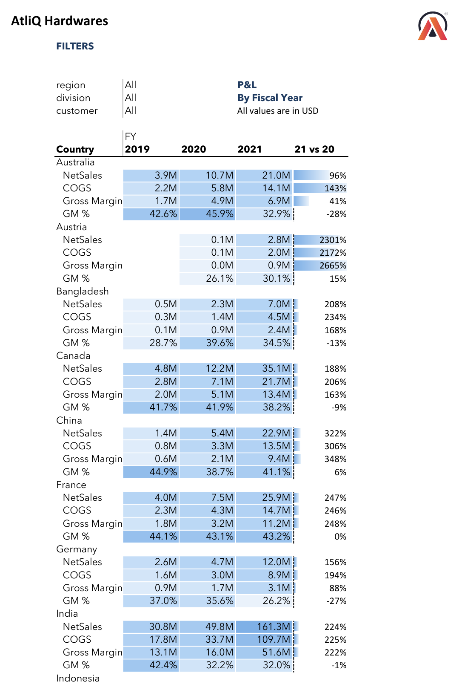

<h1 align="center">📖 Report Walkthrough</h1>

<p align="center"><b>How the reports were built, step by step: from raw CSV files to five finished sales and finance reports.</b><br>
Each report follows the same pattern: <code>Question → Approach → Report → Answer → Insight</code></p>

<p align="center"><a href="../README.md">⬅️ Back to README</a></p>

---

## 🧭 The Build Journey

```
Phase 1   Load and clean the data in Power Query
   |
   v
Phase 2   Build a fiscal date table
   |
   v
Phase 3   Model the data in Power Pivot and write DAX measures
   |
   v
Phase 4   Sales reports: customer performance and market vs target
   |
   v
Phase 5   Finance reports: P&L by year, by month and quarter, by country
   |
   v
Phase 6   Review: what to fix before sharing
```

| Phase | What happened | Reports |
|:-:|---|---|
| [**1**](#phase-1) | Imported 6 CSV files and cleaned them in Power Query | - |
| [**2**](#phase-2) | Built a date table with fiscal year, month order and quarters | - |
| [**3**](#phase-3) | Created a star schema in Power Pivot and wrote the DAX measures | - |
| [**4**](#phase-4) | Built the two sales reports, improving the target report in three versions | R1, R2 |
| [**5**](#phase-5) | Built the three P&L reports | R3, R4, R5 |
| [**6**](#phase-6) | Listed the issues found while reviewing the exports | - |

> 📌 **Fiscal year:** September to August. FY2021 = Sep 2020 to Aug 2021. All values in USD.

---

<a id="phase-1"></a>

## 🧹 Phase 1 · Load and clean the data

The raw data came as CSV files: monthly sales with costs, customers, products, markets and 2021 targets. I loaded them with **Power Query**, using one reference query (`sales ref`) that reads the whole folder, so each table points at the same source.

| Problem found | Fix in Power Query |
|---|---|
| The same customer spelled three ways: `AtliQ Exclusive`, `Atliq Exclusive`, `AltiQ Exclusive` | `Table.ReplaceValue` to one spelling, so sales are not split across three names |
| `nan` text in the market `sub_zone` and `region` columns | Replaced with `NA` |
| Negative quantities in the sales table | `Number.Abs` to make them positive |
| Headers in the first row and every column as text | Promoted headers and set data types (dates, whole numbers, decimals) |

```m
// dim_customer: fix the customer name typos
#"Replaced Value"  = Table.ReplaceValue(#"Changed Type", "Atliq Exclusive", "AtliQ Exclusive", Replacer.ReplaceText, {"customer"}),
#"Replaced Value1" = Table.ReplaceValue(#"Replaced Value", "AltiQ Exclusive", "AtliQ Exclusive", Replacer.ReplaceText, {"customer"})

// fact_sales_monthly_with_cost: negative quantities to positive
#"Calculated Absolute Value" = Table.TransformColumns(#"Changed Type", {{"Qty", Number.Abs, Int64.Type}})
```

Full code: [`power-query/queries.m`](../power-query/queries.m)

---

<a id="phase-2"></a>

## 📅 Phase 2 · Build a fiscal date table

Sales are stored by calendar month, but AtliQ reports by fiscal year (September to August). I generated a date table in Power Query and shifted each month forward by 4 months to get its fiscal year.

```m
dim_date = let
    Source = {Number.From(#date(2018,9,1))..Number.From(#date(2021,8,1))},
    ...
    #"Inserted Start of Month" = Table.AddColumn(#"Changed Type", "month", each Date.StartOfMonth([date]), type date),
    #"Added Custom"  = Table.AddColumn(#"Inserted Year", "FY Month", each Date.AddMonths([month], 4)),
    #"Added Custom1" = Table.AddColumn(#"Added Custom", "FY", each Date.Year([FY Month]))
in ...
```

In Power Pivot I then added three calculated columns to the date table:

| Column | Purpose |
|---|---|
| `mmm` | Month name for the report columns (Sep, Oct, ...) |
| `fy_month_no` | Fiscal month number (Sep = 1), so months sort in fiscal order, not January first |
| `quarter` | Fiscal quarter: Q1 = Sep to Nov, Q2 = Dec to Feb, Q3 = Mar to May, Q4 = Jun to Aug |

---

<a id="phase-3"></a>

## 🧱 Phase 3 · Data model and DAX

I loaded every query into the **Power Pivot data model** as a star schema, so one set of measures works across every report and slicer.

The diagram shows how the tables connect through their shared keys (`customer_code`, `product_code`, `date`, `market`). Check the exact relationships in Power Pivot's Diagram View.

```
                 dim_product
                      |
dim_customer --- fact_sales_monthly_with_cost --- dim_date
      |                                              |
  dim_market --------- ns_targets_2021 --------------+
```

| Measure | Logic |
|---|---|
| `NetSales` | Sum of net sales amount |
| `COGS` | Sum of `total_cogs` (freight plus manufacturing cost) |
| `Gross Margin` | NetSales minus COGS |
| `GM %` | Gross Margin divided by NetSales |
| `2019`, `2020`, `2021` | NetSales filtered to one fiscal year with `CALCULATE` |
| `Target_21`, `2021-Target`, `Gap %` | Target, gap in dollars and gap as a percentage of target |
| `Status`, `Rank` | Traffic-light label with `SWITCH(TRUE())`, and market rank with `RANKX` |

Full definitions: [`dax/measures.md`](../dax/measures.md)

---

<a id="phase-4"></a>

## 📈 Phase 4 · Sales reports

<a id="r1"></a>

### Report 1 · Customer Net Sales Performance

`Team: Sales`  `Built with: Pivot table, year measures, slicers, data bars`

> 🎯 **Business question**
>
> *How have net sales for each customer changed from FY2019 to FY2021, overall and within one market?*

**Approach:** customers on rows and the `2019`, `2020` and `2021` measures in columns, with a `21 vs 20` column beside the pivot and data bars to show size at a glance. Slicers for region, market and division let the sales team filter to one market without a new report.

<p align="center">
  <br>
  <sub><b>Figure 1</b> · All markets (first page of the report; full list in <a href="../reports/Customer_Net_Sales_Performance.pdf">the PDF</a>)</sub>
</p>

<p align="center">
  <br>
  <sub><b>Figure 2</b> · The same report with the market slicer set to USA</sub>
</p>

**✅ Answer: top customers, FY2021**

| Customer | FY2019 | FY2020 | FY2021 | FY2021 vs FY2020 |
|---|--:|--:|--:|--:|
| Amazon | $12.2M | $37.5M | **$82.1M** | 2.2x |
| AtliQ Exclusive | $9.6M | $17.7M | $61.1M | 3.5x |
| Atliq e Store | $7.2M | $23.7M | $53.0M | 2.2x |
| Sage | $4.8M | $6.4M | $20.7M | 3.2x |
| Flipkart | $2.9M | $8.3M | $19.3M | 2.3x |

> 💡 **Insight:** Amazon alone is 13.7% of FY2021 net sales, and AtliQ's own two channels add another 19.1%. In the USA, all 12 customers grew, from 2.0x (Amazon) to 3.9x (walmart).

---

<a id="r2"></a>

### Report 2 · Market Performance vs Target

`Team: Sales`  `Built with: Target table, Gap %, RANKX, SWITCH, icon sets`

> 🎯 **Business question**
>
> *Which markets met their FY2021 net sales target, and how far short is each one?*

I improved this report in three versions.

**Version 1: actual vs target in dollars.** I added the `ns_targets_2021` table to the model and a `2021-Target` measure.

<p align="center">
  <br>
  <sub><b>Figure 3</b> · Version 1: the gap in dollars only</sub>
</p>

**The change:** a $10.2M gap in the USA and a $0.9M gap in Poland can't be compared fairly in dollars, so I added **Gap %** (gap divided by target) with red data bars.

<p align="center">
  <br>
  <sub><b>Figure 4</b> · Version 2: Gap % added, so markets of different sizes can be compared</sub>
</p>

**The change:** managers still had to read every number, so I added a **Status** measure (Close, Behind, Far off), traffic-light icons and a **Rank** by FY2021 sales.

<p align="center">
  <br>
  <sub><b>Figure 5</b> · Version 3 (final): status, traffic lights and rank</sub>
</p>

**✅ Answer**

| Status | Rule | Markets |
|---|---|---|
| 🟢 Close | within 8% of target | Japan (-4.0%), Portugal (-4.1%), India (-5.6%), Philippines (-7.3%), Netherlands (-7.6%), France (-7.8%) |
| 🟡 Behind | 8% to 12% short | 14 markets, including USA (-10.4%), South Korea (-8.2%) and UK (-8.0%) |
| 🔴 Far off | more than 12% short | Poland (-15.3%), Canada (-12.6%), Spain (-12.4%) |

> 💡 **Insight:** **No market reached its target.** The company finished **$54.9M (8.4%)** short of its $653.8M target. The USA has the largest dollar gap ($10.2M), while Canada is both a top-5 market and Far off.

---

<a id="phase-5"></a>

## 💰 Phase 5 · Finance reports (P&L)

<a id="r3"></a>

### Report 3 · P&L by Fiscal Year

`Team: Finance`  `Built with: NetSales, COGS, Gross Margin, GM % measures`

> 🎯 **Business question**
>
> *How did net sales, COGS, gross margin and GM % change year on year?*

**Approach:** the four P&L measures on rows and fiscal years in columns, with a `21 vs 20` growth column. The first layout had a note that `21 vs 20` was calculated outside the pivot. The final layout keeps the same calculation with cleaner formatting.

<p align="center">
  <br>
  <sub><b>Figure 6</b> · First layout</sub>
</p>

<p align="center">
  <br>
  <sub><b>Figure 7</b> · Final layout</sub>
</p>

**✅ Answer**

| Metric | FY2019 | FY2020 | FY2021 | FY2021 vs FY2020 |
|---|--:|--:|--:|--:|
| Net Sales | $87.5M | $196.7M | **$598.9M** | +204.5% |
| COGS | $51.2M | $123.4M | $380.7M | +208.6% |
| Gross Margin | $36.2M | $73.3M | $218.2M | +197.6% |
| GM % | **41.4%** | 37.3% | **36.4%** | -0.9 pts |

> 💡 **Insight:** sales grew 6.8 times in two years, but **COGS grew faster than sales in both years**, so GM % slipped by 5 points. AtliQ now spends $63.57 in cost for every $100 of sales, up from $58.57 in FY2019.

---

<a id="r4"></a>

### Report 4 · P&L by Fiscal Month and Quarter

`Team: Finance`  `Built with: fiscal month and quarter columns, FY slicer`

> 🎯 **Business question**
>
> *How does performance move through the year, and which months drive the most sales?*

**Approach:** fiscal quarters and months in columns, sorted with `fy_month_no` so September comes first. A fiscal year slicer switches between FY2019, FY2020 and FY2021, and two comparison rows show monthly growth against the previous year.

<p align="center">
  <br>
  <sub><b>Figure 8</b> · FY2019 and FY2020</sub>
</p>

<p align="center">
  <br>
  <sub><b>Figure 9</b> · FY2021, with growth against the previous two years</sub>
</p>

**✅ Answer: net sales by fiscal quarter**

| Quarter | FY2019 | FY2020 | FY2021 |
|---|--:|--:|--:|
| Q1 (Sep to Nov) | $25.2M | $66.4M | $173.7M |
| Q2 (Dec to Feb) | $24.0M | $62.9M | $164.7M |
| Q3 (Mar to May) | $19.2M | **$19.8M** | $131.9M |
| Q4 (Jun to Aug) | $19.0M | $47.5M | $128.5M |

> 💡 **Insight:** **November and December bring in about 25% of each year's sales**, so stock and promotions should be planned around Q1 and Q2. FY2020 Q3 was almost flat on the year before because **March 2020 sales fell to $2.1M (-67.1%)** with the COVID lockdowns. Sales were back to $14.9M by June. GM % stays within a narrow band each month (about 36% to 37% in FY2021), so the margin decline is a whole-year trend, not a seasonal one.

---

<a id="r5"></a>

### Report 5 · P&L by Country

`Team: Finance`  `Built with: market on rows, P&L measures nested, data bars`

> 🎯 **Business question**
>
> *Which markets are growing profitably, and where is margin under pressure?*

**Approach:** each market on rows with its four P&L lines nested underneath, fiscal years in columns, and growth against last year.

<p align="center">
  <br>
  <sub><b>Figure 10</b> · First page of the report; all 23 markets are in <a href="../reports/PL_by_Country.pdf">the PDF</a></sub>
</p>

**✅ Answer: biggest GM % changes, FY2020 to FY2021**

| Margin improved | FY2020 | FY2021 | | Margin fell | FY2020 | FY2021 |
|---|--:|--:|---|---|--:|--:|
| New Zealand | 26.4% | **48.2%** | | Australia | 45.9% | **32.9%** |
| United Kingdom | 34.1% | **45.1%** | | Germany | 35.6% | **26.2%** |
| Japan | 37.0% | 46.5% | | Norway | 37.7% | 29.5% |
| Portugal | 36.1% | 42.1% | | Philippines | 45.1% | 39.1% |

> 💡 **Insight:** **India is 26.9% of FY2021 sales but earns only a 32.0% gross margin**, below the company's 36.4%. Because India is so large, its margin pulls the company average down. Australia nearly doubled its sales and Germany grew 2.6 times, yet both margins fell sharply, which is worth checking against discounts and freight costs.

---

<a id="phase-6"></a>

## 🔍 Phase 6 · Review notes

Issues found while checking the exported reports. Fixing them would make the reports clearer for a manager.

| # | Issue | Where | Suggested fix |
|:-:|---|---|---|
| 1 | `21 vs 20` means two different things. P&L shows growth (204.5%), customer reports show a ratio (304.5%) for the same change | Customer reports | Use `=IFERROR(E/D-1,"")` everywhere and label the column "Growth 21 vs 20" |
| 2 | The first column is labelled **Country** but lists customers | Customer reports | Rename it to **Customer** |
| 3 | `#####` in the November comparison cells | P&L by month | Widen the column before exporting |
| 4 | Monthly P&L is titled "By Fiscal Year" | P&L by month | Retitle it "By Fiscal Month and Quarter" |
| 5 | PDF exports included blank pages | Most reports | Set a print area before exporting (blank pages are removed from the PDFs in this repo) |
| 6 | Power Query uses fixed local paths (`C:\Users\...`) | All queries | Store the folder path in one parameter so anyone can refresh the file |

---

<p align="center">⬅️ <a href="../README.md">Back to README</a></p>
